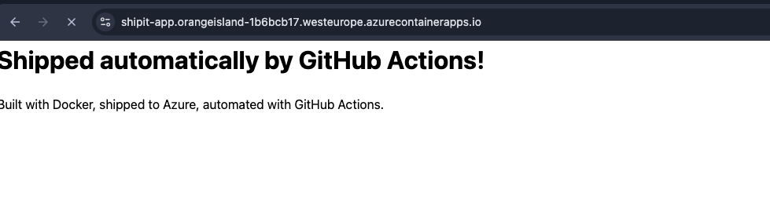
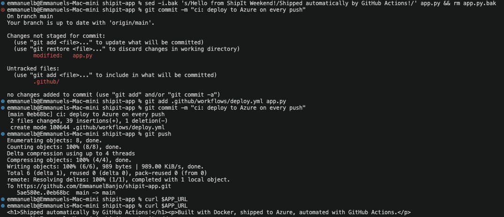
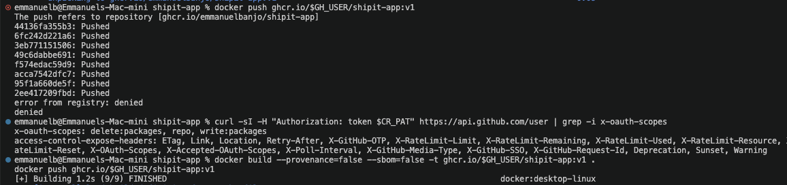
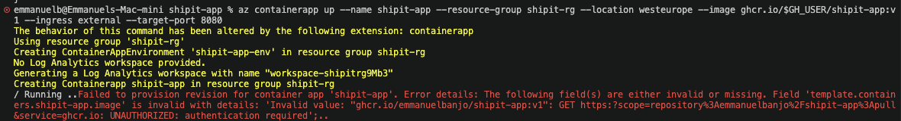
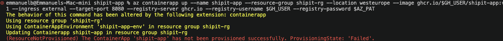

[](https://skill-sch.com/certificate/shipit-efa9145a74e4)


# shipit-app

A small Python web app that I containerised with Docker, pushed to GitHub Container Registry (GHCR), and deployed to Azure Container Apps. A GitHub Actions workflow redeploys it automatically every time I push to `main`.

The app itself is deliberately simple. The point of this project was the pipeline around it, and getting it working meant fixing a handful of real problems along the way. Those are documented below.




---

## How it works

```
git push to main
      │
      ▼
GitHub Actions
  ├── builds the Docker image
  ├── pushes it to ghcr.io/emmanuelbanjo/shipit-app
  └── tells Azure to use the new image
      │
      ▼
Azure Container Apps pulls the image and serves it
```

## Stack

| Part | What I used |
|---|---|
| App | Python 3.12, standard library only (`http.server`) |
| Container | Docker, based on `python:3.12-slim` |
| Registry | GitHub Container Registry (GHCR), private package |
| Hosting | Azure Container Apps, West Europe |
| CI/CD | GitHub Actions |

## Project structure

```
shipit-app/
├── app.py                        # the web app
├── Dockerfile                    # how the image is built
└── .github/workflows/deploy.yml  # build, push and deploy on every push to main
```

---

## What I did

### 1. Wrote the app

`app.py` is a basic HTTP server that returns one HTML page. It reads the port from the `PORT` environment variable and falls back to `8080`, and it listens on `0.0.0.0` so it can be reached from outside the container.


### 2. Containerised it

The Dockerfile starts from `python:3.12-slim`, sets `/app` as the working directory, and copies in `app.py`. It also has this label:

```dockerfile
LABEL org.opencontainers.image.source=https://github.com/emmanuelbanjo/shipit-app
```

That label tells GHCR which repository the image belongs to, so the package can be linked to this repo.

To run it locally:

```bash
docker build -t shipit-app .
docker run -p 8080:8080 shipit-app
# then open http://localhost:8080
```

### 3. Pushed the image to GHCR

```bash
export CR_PAT=<github-token-with-write:packages>
export GH_USER=emmanuelbanjo

echo $CR_PAT | docker login ghcr.io -u $GH_USER --password-stdin
docker build --platform linux/amd64 --provenance=false --sbom=false -t ghcr.io/$GH_USER/shipit-app:v1 .
docker push ghcr.io/$GH_USER/shipit-app:v1
```

The `--platform`, `--provenance` and `--sbom` flags are all there because of problems I hit. See the issues section below.

### 4. Deployed to Azure Container Apps

```bash
az containerapp up \
  --name shipit-app \
  --resource-group shipit-rg \
  --location westeurope \
  --image ghcr.io/$GH_USER/shipit-app:v1 \
  --ingress external \
  --target-port 8080 \
  --registry-server ghcr.io \
  --registry-username $GH_USER \
  --registry-password $AZ_PAT
```

This creates the resource group, a Container Apps environment (`shipit-app-env`), a Log Analytics workspace, and the app itself. `$AZ_PAT` is a separate GitHub token with only `read:packages`, because Azure only needs to pull the image, not push or delete it.

To get the app's URL:

```bash
APP_URL=https://$(az containerapp show --name shipit-app --resource-group shipit-rg --query properties.configuration.ingress.fqdn -o tsv)
curl $APP_URL
```

### 5. Automated it with GitHub Actions

`.github/workflows/deploy.yml` runs on every push to `main`. It:

1. Checks out the code
2. Logs in to GHCR using the built-in `GITHUB_TOKEN`
3. Builds and pushes a new image
4. Logs in to Azure using the `AZURE_CREDENTIALS` secret
5. Runs `az containerapp update` to point the app at the new image

To prove it worked, I changed the message in `app.py` to "Shipped automatically by GitHub Actions!", pushed, and checked that the live app updated without me running anything by hand.



---

## Issues I hit and how I fixed them

### Issue 1: `docker push` uploaded every layer, then failed with `denied`

```
44136fa355b3: Pushed
...
error from registry: denied
```

**Cause:** Docker Desktop adds a provenance attestation and builds a manifest list on top of the image by default. GHCR rejected that final manifest, even though the layers themselves uploaded fine.

To rule out the token, I checked its scopes:

```bash
curl -sI -H "Authorization: token $CR_PAT" https://api.github.com/user | grep -i x-oauth-scopes
# x-oauth-scopes: delete:packages, repo, write:packages
```

The scopes were fine, so the token wasn't the problem.

**Fix:** Rebuilt without the attestation and SBOM:

```bash
docker build --provenance=false --sbom=false -t ghcr.io/$GH_USER/shipit-app:v1 .
```

The push went through after that.



---

### Issue 2: Azure couldn't pull the image (`UNAUTHORIZED`)

```
Field 'template.containers.shipit-app.image' is invalid ... UNAUTHORIZED: authentication required
```

**Cause:** The package on GHCR is private. Being logged in to GHCR on my machine doesn't help Azure, which needs its own credentials to pull.

**Fix:** Passed registry credentials to `az containerapp up` using a separate read-only token (`read:packages` only):

```bash
--registry-server ghcr.io --registry-username $GH_USER --registry-password $AZ_PAT
```



---

### Issue 3: Deployment stuck in `Failed` state

```
(ResourceNotProvisioned) The ContainerApp 'shipit-app' has not been provisioned successfully. ProvisioningState: 'Failed'.
```

**Cause:** Two things. First, I built the image on an Apple Silicon Mac mini, so Docker produced an ARM image by default. Azure Container Apps only runs `linux/amd64`. Second, the earlier failed attempts had left the app in a `Failed` state, and updating it kept failing.

**Fix:** Rebuilt for the right architecture, pushed again, deleted the broken app, and redeployed:

```bash
docker build --platform linux/amd64 --provenance=false --sbom=false -t ghcr.io/$GH_USER/shipit-app:v1 .
docker push ghcr.io/$GH_USER/shipit-app:v1

az containerapp delete --name shipit-app --resource-group shipit-rg --yes
# then ran az containerapp up again
```

The GitHub Actions runners are already amd64, so the pipeline doesn't need the `--platform` flag.



---

### Issue 4: GitHub Actions got `403 Forbidden` when pushing

```
unknown: unexpected status from HEAD request to https://ghcr.io/v2/emmanuelbanjo/shipit-app/blobs/sha256:...: 403 Forbidden
```

**Cause:** I created the package by hand with my personal token, so it wasn't connected to this repo. The workflow logs in with `GITHUB_TOKEN`, and that token can only write to packages its repo has been given access to.

**Fix:**

1. In the package's **Package settings**, under **Manage Actions access**, added the `shipit-app` repo with the **Write** role.
2. Made sure the workflow requests package permissions:

```yaml
permissions:
  contents: read
  packages: write
```

Then re-ran the failed job.


---

## Secrets and tokens

| Name | Where | What it's for |
|---|---|---|
| `CR_PAT` | Local only | Pushing images to GHCR by hand (`write:packages`) |
| `AZ_PAT` | Stored in the Azure app config | Letting Azure pull the private image (`read:packages`) |
| `AZURE_CREDENTIALS` | GitHub repo secret | Letting the workflow log in to Azure |
| `GITHUB_TOKEN` | Built into Actions | Letting the workflow push to GHCR |

None of these are committed to the repo.

## Clean up

Container Apps can scale to zero, so the app costs very little, but the Log Analytics workspace bills on log volume. To remove everything:

```bash
az group delete --name shipit-rg --yes
```

## What I took away from this

- Most push and deploy failures came from permissions and defaults, not from the app itself.
- The step where an error appears tells you a lot. Layers uploading and then the manifest failing pointed to the manifest, not the login.
- Building on Apple Silicon and deploying to the cloud means always thinking about CPU architecture.
- Give each consumer its own token with only the scopes it needs.